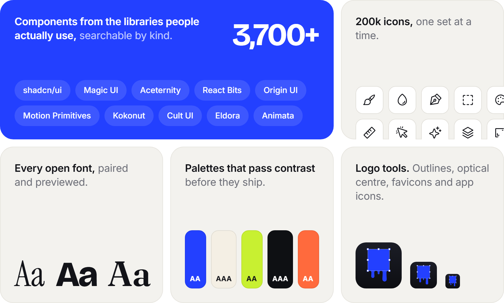
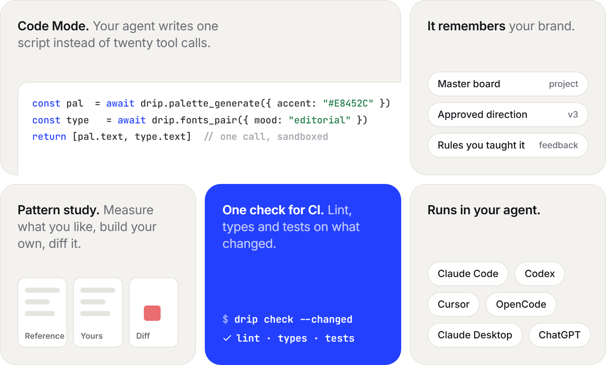

<p align="center">
  <picture>
    <source media="(prefers-color-scheme: dark)" srcset="https://raw.githubusercontent.com/8bitgfx/drip/brand/assets/brand/wordmark-dark.png">
    
  </picture>
</p>

<p align="center">
  <a href="https://github.com/8bitgfx/drip/actions/workflows/ci.yml"></a>
  
  
</p>


Ask a coding agent for a landing page and you get the same one every time. Drip makes it work like a design team instead: it studies real sites first, asks you a few clickable questions, builds from finished components that library designers already tuned, checks the page at phone and desktop size, and shows you the finished page.

## How it works

1. **Look.** Drip shoots 3-4 shipped sites in your category (and your current site, for a redesign) and a gallery of the pattern, and takes two or three decisions from them.
2. **Deal.** It deals a hero layout, palette and type for your kind of product, and a shortlist of finished pieces for every section.
3. **Ask.** One round of clickable questions: which direction, what must stay, what pictures you have. Skip it by saying "don't ask".
4. **Build as a team.** The director (your session's model) picks the pieces by looking at them and writes a spec per section; builder agents (Sonnet) write the sections in parallel; helper agents (Haiku) do the small jobs.
5. **Check.** Every page is measured at 1440 and 390 px. Anything broken (cut off, covered, repeated pictures, unfilled placeholders) is fixed before you see it. A critic agent gives one honest review at the end.

Hooks hold each step: no UI before the look, no builders before the pieces were looked at, no "done" with the latest version unchecked. Watch the team work with **Drip Film**: a live view of each agent and the page as it grows, and a montage at the end.

## What's in the box

<picture>
  <source media="(prefers-color-scheme: dark)" srcset="https://raw.githubusercontent.com/8bitgfx/drip/brand/assets/readme/tools-dark.png">
  
</picture>

- **Pieces before homemade:** search ~3,300 free components across 15 libraries by what you need ("image comparison", "kanban", "pricing toggle"): shadcn and its blocks, Magic UI, React Bits, Cult UI, Smooth UI, Spell UI, Aceternity, efferd, bencho, Kibo, coss, Eldora, Motion Primitives, Animate UI and taste-skill. Every result is checked to install without a login and previewed from its own page, cropped to the component. Own a paid kit (Aceternity Pro, Breeze UI…)? Tell Drip once and it uses it too.
- **Landing pages and app screens:** software pages are built as React + Tailwind so library pieces install as they are; products, services and places as one static page.
- **Also:** references from Dribbble, Awwwards, Godly and more, licensed photos, a [Studio](docs/STUDIO.md) for original art, shader backgrounds and mockups on real device models, and image generation with your own OpenAI or Gemini key. No key is required.

## Built for agents

<picture>
  <source media="(prefers-color-scheme: dark)" srcset="https://raw.githubusercontent.com/8bitgfx/drip/brand/assets/readme/agents-dark.png">
  
</picture>

- **Code Mode:** `drip_search` finds tools, `drip_execute` runs a short script against them in a sandbox. Same tools from a terminal with `drip run --file workflow.js`. [Code Mode](docs/CODEMODE.md)
- **CLI and CI:** every tool is a command (`drip call <tool>`), and `drip check --changed` gates a pull request. [CLI](docs/CLI.md)
- **Memory and patterns:** [Project memory](docs/PROJECT_MEMORY.md) · [Pattern study](docs/PATTERNS.md) · [Your own components](docs/COMPONENTS.md)
- **Niche packs that keep learning:** `/drip:adapt roblox ui` researches a niche once; the pack switches on by itself in any later task and learns from your reactions. Share one as a single file (`pack_export`, privacy-checked; `pack_import` on the other side), no fork needed.
- **Drip Film:** [watch the agents build](docs/FILM.md), in any IDE.

## Install

**Claude Code** (full plugin: skills, the critic agent, and hooks that enforce the loop)

```text
/plugin marketplace add 8bitgfx/drip
/plugin install drip@drip-design
```

Restart Claude Code, then run `/drip:design a pricing page for my app`.

**Codex** (native plugin)

```bash
codex plugin marketplace add 8bitgfx/drip
```

Open **Plugins** in the ChatGPT desktop app or `/plugins` in Codex. Install **Drip** from **Drip Design**, review its hooks with `/hooks`, and start a new session. Try `@Drip design a pricing page for my app`.

See [Codex setup](docs/HOSTS.md#codex-native-plugin) for the independent critic and for switching from the direct installer.

**Cursor, OpenCode, Claude Desktop, ChatGPT desktop** (direct installer)

```bash
git clone https://github.com/8bitgfx/drip ~/drip && cd ~/drip
node mcp/dist/drip-mcp.mjs install --agent cursor   # or opencode, claude-desktop, chatgpt
```

It registers Drip's local engine, copies the skills and the critic, and wires hooks where the app has them. Any other MCP client can run `node ~/drip/mcp/dist/drip-mcp.mjs` as a stdio server. What each app enforces: [docs/HOSTS.md](docs/HOSTS.md).

Needs Node 22+ and Chrome or Edge for screenshots.

## Commands (Claude Code)

| Command | What it does |
|---|---|
| `/drip:design` | Design a page, screen, logo or polish pass |
| `/drip:critic` | Independent review of any page, screenshot or image |
| `/drip:adapt` | Teach it a niche: game UI, fintech, e-commerce… |
| `/drip:settings` | Status, API keys, pause or stop a task |

## Docs

[Architecture](docs/ARCHITECTURE.md) · [Drip Film](docs/FILM.md) · [Project memory](docs/PROJECT_MEMORY.md) · [Pattern study](docs/PATTERNS.md) · [Components](docs/COMPONENTS.md) · [Sources](docs/SOURCES.md) · [Studio](docs/STUDIO.md) · [CLI](docs/CLI.md) · [Code Mode](docs/CODEMODE.md) · [Other agents](docs/HOSTS.md) · [Customise the rules](docs/CUSTOMISE.md) · [Troubleshooting](docs/TROUBLESHOOTING.md) · [Credits](CREDITS.md)

<sub>MIT. Design guides are written in our own words from open sources, credited in CREDITS.md. References are for study, never for copying.</sub>
