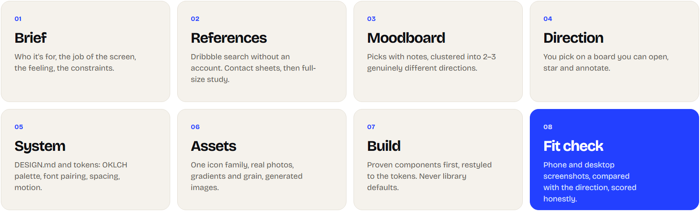
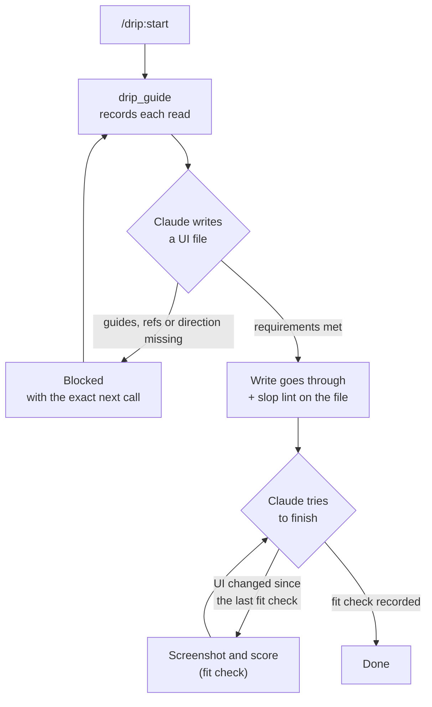
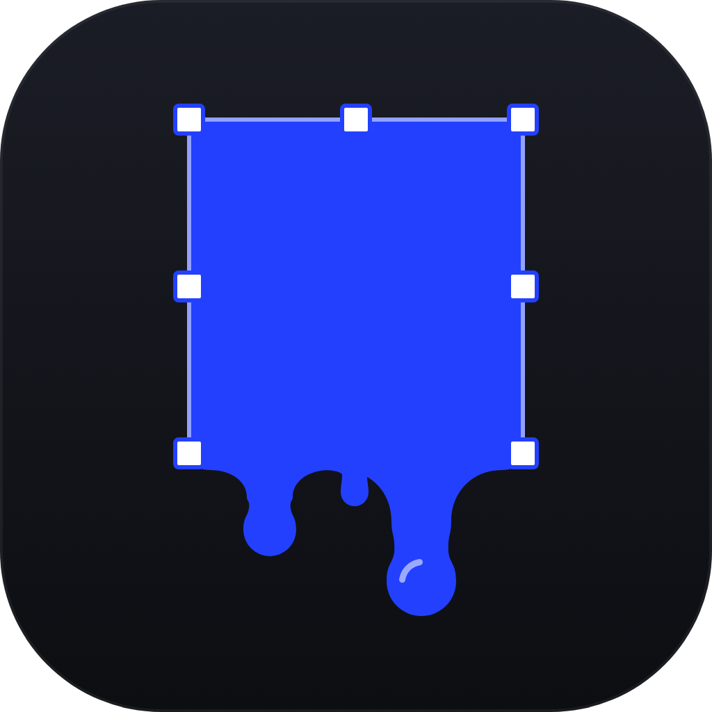

<p align="center">
  <picture>
    <source media="(prefers-color-scheme: dark)" srcset="assets/brand/wordmark-dark.png">
    
  </picture>
</p>

<h3 align="center">Give Claude drip.</h3>

<p align="center">
  A design director for Claude Code: real references, moodboards, design systems and fit checks, so your UI stops looking AI-made.
</p>

<p align="center">
  <a href="LICENSE"></a>
  <a href="#quickstart"></a>
  
  
  <a href="https://github.com/8bitgfx/drip/stargazers"></a>
</p>

<p align="center">
  <a href="#quickstart">Quickstart</a> ·
  <a href="#the-loop">The loop</a> ·
  <a href="#what-claude-gets">What Claude gets</a> ·
  <a href="#commands">Commands</a> ·
  <a href="#how-it-stays-honest">How it stays honest</a> ·
  <a href="#configuration">Configuration</a> ·
  <a href="#troubleshooting">Troubleshooting</a>
</p>

<br>

Ask an agent for a landing page and you get the same page everyone gets: a purple gradient, a centred headline, three icon cards, "Unlock seamless growth". Not because the model can't design, but because it skips everything a designer does before touching code.

**Drip makes it do those steps, and gives it the tools to do them well.**

## Quickstart

```text
/plugin marketplace add 8bitgfx/drip
/plugin install drip@drip-design
```

Restart Claude Code (or run `/reload-plugins`), then:

```text
/drip:start a pricing page for our dev-tools SaaS
```

That's it. Claude researches references on Dribbble, builds a moodboard with 2–3 directions for you to pick from, writes a design system, builds with real components and checks its own work on screenshots before it hands back.

> [!NOTE]
> **Opt-in by default.** Drip only steps in while a Drip task is running (`/drip:start`). The rest of the time it stays out of your way: no blocking, no nudges.

## The loop

The same process a product designer runs, in order. During a Drip task Claude can't start building until the guides are read, the references studied and a direction chosen.

<picture>
  <source media="(prefers-color-scheme: dark)" srcset="assets/brand/loop-dark.png">
  
</picture>

Then a polish pass for the details nobody notices until they're missing. Small tweaks to existing UI get a **quick loop**: read the relevant guides, change, lint, fit check.

## What Claude gets

| A designer… | Drip gives Claude |
|---|---|
| looks at what good work in the space looks like | **Dribbble search without an account**: keywords, tags, feeds, designers, contact sheets of 48 shots, full-size study |
| collects references and picks a direction with the client | **Moodboards** you can open, star and annotate, with 2–3 genuinely different directions |
| writes the system down before building | **Palettes** (OKLCH, contrast-checked), **font pairings** with specimens, a `DESIGN.md` |
| uses proven parts | **3,700+ components** from shadcn, coss ui, Kibo UI, Magic UI, Aceternity, React Bits, Motion Primitives, Animate UI, Cult UI, plus 500+ registries |
| sources real assets | **200k icons**, every open font, **photos with licences**, **mesh gradients** and grain, **image generation** with your own OpenAI or Gemini key |
| checks the work with fresh eyes | **Fit checks**: phone and desktop screenshots, side by side with the chosen direction, a slop lint and an honest 8-axis score |

Behind it are **22 skills** fusing the best design guidance out there (Impeccable, Taste Skill, Emil Kowalski, Make Interfaces Feel Better, UI UX Pro Max, Hallmark, unslop-ui, Stageshow and more), rewritten into one voice and organised by craft. See [CREDITS.md](CREDITS.md).

## Commands

| Command | What it does |
|---|---|
| `/drip:start <what>` | Design something: a new page, a component, a redesign, or a polish pass |
| `/drip:refs <subject>` | Find and study references |
| `/drip:board <what>` | Build a moodboard with directions |
| `/drip:fitcheck <url>` | Screenshot, compare, score and fix a page |
| `/drip:status` | Where the current task stands |
| `/drip:keys` | Add optional API keys (in a local page, never in chat) |
| `/drip:skip` | Turn the checks off for the current task |

The craft skills (colour, type, layout, motion, copy, accessibility and the rest) don't clutter the menu. Claude loads them on its own when the work needs them.

## How it stays honest

Agents skim instructions. Drip doesn't rely on them reading.



- **Guides arrive through a tool.** The detailed guides come from `drip_guide`, which records the read. "I read the skill" becomes checkable.
- **Gates.** During a Drip task, writing a UI file is blocked until the required guides are read, references are studied and a direction is chosen. The block message names the exact next call.
- **Lint on every edit.** Each UI edit is scanned for slop tells (AI gradients, emoji icons, filler copy, removed focus rings, `transition: all`…) and the problems go straight back to Claude.
- **No finishing blind.** After changing UI, Claude can't end its turn until it has screenshotted and scored the result. It gives up after three tries, so you never get stuck.

> [!TIP]
> Teams that want the checks on every UI change, not just during a Drip task, can set `"gates": { "mode": "always" }` in `.drip/config.json`.

## Requirements

- Claude Code with plugin support
- Node.js 20+
- Chrome or Edge, for screenshots and previews (optional but strongly recommended)
- No API keys for the core. Optional keys: OpenAI or Gemini (image generation), Unsplash or Pexels (better photo search)

## Configuration

Everything is plain files: gates and thresholds, which files count as UI, your own slop rules, your own component registries, custom image providers.

<details>
<summary><b>A taste of <code>.drip/config.json</code></b></summary>

<br>

```json
{
  "gates": {
    "mode": "task",
    "enforce": true,
    "minRefsViewed": 6,
    "minBoardItems": 8,
    "requireDirection": true,
    "requireFitcheck": true
  },
  "modules": { "refs": true, "board": true, "components": true, "assets": true, "gen": true, "fitcheck": true },
  "fitcheck": { "chromePath": "" }
}
```

- `gates.mode`: `"task"` (default) acts only while a Drip task is open; `"always"` applies to every UI write.
- `gates.enforce: false` makes Drip advisory: no blocking, the guides and tools still work.
- `modules` turns tool groups off (fewer tools in Claude's context).

</details>

Your own slop rules, component registries and image providers: [docs/CUSTOMISE.md](docs/CUSTOMISE.md).

## Troubleshooting

| Symptom | Fix |
|---|---|
| Claude says the Drip tools aren't available | Run `/mcp` and check `plugin:drip:drip` is connected; reconnect it if not. Claude Code loads plugin tools lazily, so Drip's skills tell Claude the exact names to load. |
| Dribbble results stop or `refs_view` shows only the cover image | Dribbble rate-limits shot pages. Drip backs off and falls back to the image; wait a minute between heavy research runs. |
| No screenshots or previews | Install Chrome or Edge, or set `fitcheck.chromePath` in `.drip/config.json`. |
| Drip blocked a write you wanted | `/drip:status` shows what's missing. `/drip:skip` turns the checks off for the current task. |

More in [docs/TROUBLESHOOTING.md](docs/TROUBLESHOOTING.md).

<details>
<summary><b>Under the hood</b></summary>

<br>

| Folder | What's in it |
|---|---|
| `skills/` | The guides (Markdown): the director skill plus one per craft |
| `rules/` | Shared rules: hard rules, slop tells, per-surface rules, licences |
| `data/` | The component catalogue, font pairings and slop rules |
| `mcp/` | The server, bundled into one file so it runs with plain `node`, with no install step |
| `hooks/` | Small Node scripts: the write gate, the recorder and lint, the stop guard |

Details: [docs/ARCHITECTURE.md](docs/ARCHITECTURE.md).

</details>

> [!IMPORTANT]
> References are for studying, never copying. Drip keeps credits on every board, logs licences for every asset it saves, and keeps its Dribbble traffic slow and cached.

## Licence

MIT. Drip's guides adapt MIT and Apache-2.0 sources with credit; see [CREDITS.md](CREDITS.md). Brand files and how they're made: [assets/brand/BRAND.md](assets/brand/BRAND.md).

<br>

<p align="center">
  
</p>
