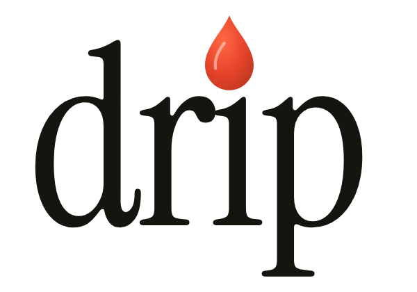
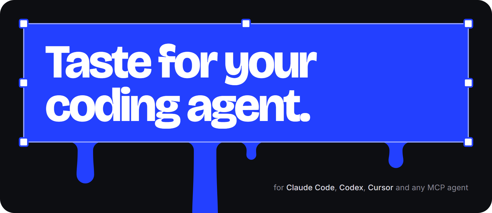
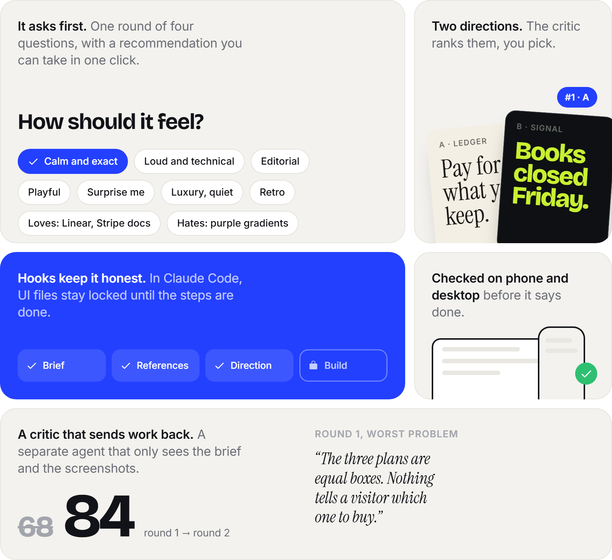

<p align="center">
  <picture>
    <source media="(prefers-color-scheme: dark)" srcset="https://raw.githubusercontent.com/8bitgfx/drip/brand/assets/brand/wordmark-dark.png">
    
  </picture>
</p>

<p align="center">
  <a href="https://github.com/8bitgfx/drip/actions/workflows/ci.yml"></a>
  
  
</p>



Ask a coding agent for a landing page and you get the same one every time. Drip gives it a designer's process instead: it asks what you want, studies real work, shows you two directions, builds the one you pick, and has an independent critic review the result before anything is called done.

## How it works

<picture>
  <source media="(prefers-color-scheme: dark)" srcset="https://raw.githubusercontent.com/8bitgfx/drip/brand/assets/readme/loop-dark.png">
  
</picture>

## What's in the box

<picture>
  <source media="(prefers-color-scheme: dark)" srcset="https://raw.githubusercontent.com/8bitgfx/drip/brand/assets/readme/tools-dark.png">
  
</picture>

Also: references from Dribbble, Awwwards, Godly and more, licensed photos, a [Studio](docs/STUDIO.md) for original art and shader backgrounds, and image generation with your own OpenAI or Gemini key. No key is required.

## Built for agents

<picture>
  <source media="(prefers-color-scheme: dark)" srcset="https://raw.githubusercontent.com/8bitgfx/drip/brand/assets/readme/agents-dark.png">
  
</picture>

- **Code Mode:** `drip_search` finds tools, `drip_execute` runs a short script against them in a sandbox. Same tools from a terminal with `drip run --file workflow.js`. [Code Mode](docs/CODEMODE.md)
- **CLI and CI:** every tool is a command (`drip call <tool>`), and `drip check --changed` gates a pull request. [CLI](docs/CLI.md)
- **Memory and patterns:** [Project memory](docs/PROJECT_MEMORY.md) · [Pattern study](docs/PATTERNS.md) · [Your own components](docs/COMPONENTS.md)

## Install

**Claude Code** (full plugin: skills, the critic agent, and hooks that enforce the loop)

```text
/plugin marketplace add 8bitgfx/drip
/plugin install drip@drip-design
```

Restart Claude Code, then run `/drip:design a pricing page for my app`.

**Codex, Cursor, OpenCode, Claude Desktop, ChatGPT desktop**

```bash
git clone https://github.com/8bitgfx/drip ~/drip && cd ~/drip
node mcp/dist/drip-mcp.mjs install --agent codex   # or cursor, opencode, claude-desktop, chatgpt
```

It registers Drip's local engine, copies the skills and the critic, and wires hooks where the app has them. Any other MCP client can run `node ~/drip/mcp/dist/drip-mcp.mjs` as a stdio server. What each app enforces: [docs/HOSTS.md](docs/HOSTS.md).

Needs Node 22+ and Chrome or Edge for screenshots.

## Commands (Claude Code)

| Command | What it does |
|---|---|
| `/drip:design` | Design a page, screen, logo or polish pass |
| `/drip:critic` | Independent review of any page, screenshot or image |
| `/drip:adapt` | Teach it a niche: game UI, fintech, e-commerce… |
| `/drip:settings` | Status, API keys, pause or stop a task |

## Docs

[Architecture](docs/ARCHITECTURE.md) · [Project memory](docs/PROJECT_MEMORY.md) · [Pattern study](docs/PATTERNS.md) · [Components](docs/COMPONENTS.md) · [Sources](docs/SOURCES.md) · [Studio](docs/STUDIO.md) · [CLI](docs/CLI.md) · [Code Mode](docs/CODEMODE.md) · [Other agents](docs/HOSTS.md) · [Customise the rules](docs/CUSTOMISE.md) · [Troubleshooting](docs/TROUBLESHOOTING.md) · [Credits](CREDITS.md)

<sub>MIT. Design guides are written in our own words from open sources, credited in CREDITS.md. References are for study, never for copying.</sub>
