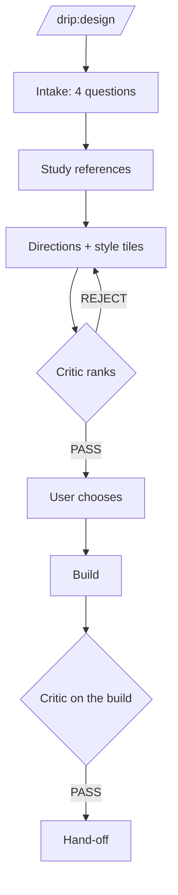

# README visuals: heroes, GIFs, light/dark, diagrams and rendered text

A README's visuals do the work prose can't: they prove the product exists and works, in the time a visitor gives the page. They are shown in a column about 830 px wide on desktop and the full width of a phone, on a white or near-black ground depending on the visitor's theme, through GitHub's image proxy, with no CSS and no webfonts. Everything here follows from those limits.

## Pick the hero

| Project | Best hero | Second choice | Never |
|---|---|---|---|
| App with a UI | a cropped screenshot of the main screen doing its job | a ≤ 8 s GIF of the core flow | a laptop mockup, a logo alone |
| CLI | a rendered terminal: one real command and its real output | a ≤ 8 s GIF of it running | a screenshot of a whole terminal window with a desktop behind it |
| Library | code beside what it produces | a code block + output block | an abstract banner |
| Plugin / pipeline | `flowchart TD` of the flow, real names | a screenshot inside the host app | stock "AI" art |
| Visual tool (design, charts) | a grid of real outputs | a before/after pair | an illustration of a person using it |

Capturing and staging the product (crops, frames, demo animations): `drip_guide productshots`.

## Size and sharpness

- Export at **2x** the shown size: a hero shown at 830 px wide is a 1660 px PNG with `width="830"`.
- Crop to the part that matters. Readable text at column width is the test: if UI text is under ~11 px when shown, crop tighter.
- PNG for UI and text; JPG (quality ~85) only for photos. Keep each still under ~1 MB.
- Every `` has `alt` that says what it shows ("The board with three critic-ranked tiles"), not "screenshot".

## Light and dark

GitHub follows the visitor's theme. A light screenshot on a dark page is a glaring white box; a transparent PNG with black text vanishes on dark.

```html
<picture>
  <source media="(prefers-color-scheme: dark)" srcset="docs/readme/hero-dark.png">
  <source media="(prefers-color-scheme: light)" srcset="docs/readme/hero-light.png">
  
</picture>
```

- Capture the product in both themes when it has both; otherwise give the image its own framed ground (a rounded card with a 1px border and padding) that sits well on white and near-black.
- Logos and diagrams with transparent backgrounds need a dark-mode variant with light ink.
- Check both themes in the rendered page, not in your editor.

## GIFs and video

| Rule | Value |
|---|---|
| Length | ≤ 8 s, one action, loops cleanly |
| Crop | only the region that changes plus enough context to read it |
| Size | ≤ 5 MB; 15-20 fps is plenty for UI |
| First frame | the payoff or a readable still: it is what shows before it loads and in reduced-motion previews |
| Cursor | moves with purpose, never covers what it clicks |

- Record at 2x, crop, then cut frames and palette (gifski or ffmpeg's palettegen/paletteuse) to hit the size.
- For longer demos, an MP4 attached through GitHub's web editor plays inline with controls; link anything longer than 30 s to a video page instead.

## Mermaid diagrams

````markdown

````

- **`flowchart TD`, always.** `LR` lays every node in one row and GitHub scales it down to fit the column: tiny boxes, unreadable labels.
- 5-12 nodes, labels of 1-5 words, real names from the code.
- One diagram per idea. Two small diagrams beat one with 25 nodes.
- Mermaid follows the theme on its own; don't set colours unless you check both themes.

## Text inside images

GitHub serves images through a proxy into an `` tag. An SVG loaded that way **cannot fetch fonts** (no `@import`, no `@font-face` from a URL, no system font you can count on), so a banner set in your brand face falls back to a default serif.

| Need | Do |
|---|---|
| A banner or social card in the brand typeface | render it to PNG at 2x (headless browser screenshot of an HTML page that loads the font) |
| A crisp SVG logo or wordmark | convert text to outlined paths before committing |
| A terminal capture | render to PNG, or an SVG whose text is outlined; a monospace system stack is acceptable only if the look doesn't matter |
| Text that must be searchable or translated | keep it in Markdown, not in an image |

## The social preview

The image people see when the repo is shared on social sites and chat apps.

- **1280×640 PNG** (minimum 640×320), under 1 MB, safe area away from the edges (some apps crop to a square).
- Holds: the name, the one-liner, and a crop of the hero visual. Readable at 400 px wide.
- Render it like a banner (PNG from HTML with the real fonts).
- **Upload is manual**: Settings → General → Social preview → Edit. There is no API and no `gh` command for it. Give the user the file path and those steps.

## Checking the visuals

1. Push to a branch; open the README on github.com.
2. `fitcheck_shot` the page at desktop and phone. Switch the theme (`dark: true`) and shoot again.
3. Look for: unreadable crops, white boxes on dark, invisible logos, fallback fonts in banners, LR diagrams, GIFs that start on a blank frame.
4. Then the critic: `critic_prepare({ kind: "any", targets: ["<branch README URL>"] })` → `drip:critic` → `critic_record`.

## Sources

Drip's own work, from GitHub's documented support for `<picture>` with `prefers-color-scheme`, mermaid diagrams and the repository social preview setting, and from how browsers load SVGs inside `` (no external resources). Capture and animation craft is shared with `drip_guide productshots`.
